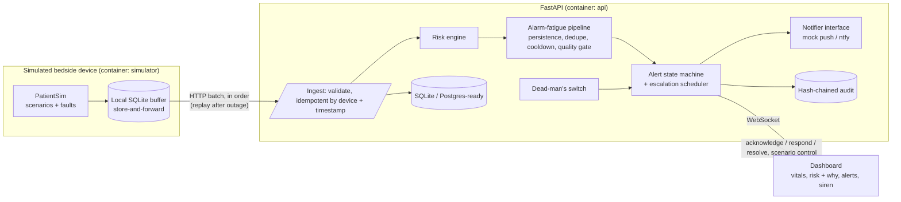

# Ward Zero: A Hospital That Fits Inside a Bedroom

**Intelligent Home Healthcare Monitoring and Response System**
Submission for *Operation Ward Zero* (Nursio Innovation × Wooble): **Sense → Understand → Predict → Alert → Respond**

> **Experimental prototype. Not a medical device.** All data is synthetic. The system makes no diagnosis, gives no treatment advice and makes no claim of clinical accuracy. All clinical thresholds are illustrative.

| Resource | Link |
|---|---|
| Live UI demo (browser-only, synthetic data) | https://wardzero.vercel.app/ |
| Source code | https://github.com/Presika-S/wardzero |
| Demonstration video (~3 min) | _add link before submission_ |
| Technical documentation | [`docs/TECHNICAL.md`](docs/TECHNICAL.md) |
| Model card (synthetic data) | [`docs/model_card.json`](docs/model_card.json) |

---

## 1. Problem

Patients recovering at home rely on family caregivers who have no continuous monitoring or early-warning support. Existing home-monitoring approaches commonly fail in the following ways:

| Limitation | Consequence | Ward Zero response |
|---|---|---|
| Alarm fatigue: most alarms are not actionable [1][2] | Caregivers begin to ignore alarms | Alert tiers, persistence rule, de-duplication, cooldown, signal-quality gate, and a visible suppression ledger |
| Snapshot scores and population thresholds [3] | Slow deterioration is missed; an individual's normal differs from textbook ranges | Personal baseline and 6 h / 12 h trend features producing a 24–48 h risk band |
| Unexplained predictions | Clinicians cannot trust the output | Interpretable model; every alert lists plain-language reasons with exact per-feature contributions |
| No closed response loop | No evidence that a human responded | Escalation Caregiver 1 → Caregiver 2 → Emergency contact; Acknowledge / Responding / Resolve; response times logged |
| Silent failure | A failed sensor or lost connection resembles "patient is stable" | Dead-man's switch ("NO DATA — UNMONITORED"), store-and-forward buffering, ordered replay |
| No accountability trail | Actions cannot be reviewed | Hash-chained audit log of every alert and action |

## 2. System Components

| Component | Description | Uses backend and ML model |
|---|---|---|
| **Integrated system** (`docker compose up`, http://localhost:8000) | Simulated bedside device → FastAPI ingestion → risk engine and trained ML model → alert state machine and escalation → live dashboard (WebSocket) → audit log. **This is the working prototype.** | Yes |
| **UI demo** (`web/ward-zero.html`, deployed at https://wardzero.vercel.app/) | Multi-patient hospital-at-home interface (Doctor Ward, Patient Deep-Dive, Caregiver Portal, Simulation Lab, IoT Devices, Audit Trail, Risk Model Card, Safety & Limits). Runs entirely in the browser using simulated data and in-browser logic. Details: [`docs/FRONTEND_DEMO.md`](docs/FRONTEND_DEMO.md). | No |
| **Hardware example** (`hardware/`) | Example ESP32 sketch showing how a physical device would post readings to `/api/ingest`. Not tested on real hardware. | No |

The Python API and Docker stack do not run on Vercel; only the static UI demo is hosted there.

## 3. Key Features

- **Simulator:** temperature, heart rate, blood pressure and SpO₂ with scenarios *stable*, *slow deterioration*, *acute event*, *sensor fault* (probe-off, flatline), *network outage* and *power loss*; adjustable simulation speed.
- **Ingestion:** validated, idempotent by (device, timestamp), stale-session guard, WebSocket push to the dashboard.
- **Reliability:** device-side store-and-forward buffer with ordered replay; dead-man's switch; signal-quality gating; battery and power alerts; crash recovery of engine state from the database.
- **Risk engine:** data-quality gate; rule-based safety floor; personal baseline; interpretable trend model; caregiver-note context (English, Tamil, Hindi).
- **Alerting:** Info / Warning / Critical tiers; persistence, de-duplication and cooldown; siren, full-screen flash and push-style notification (optional real push through ntfy).
- **Caregiver workflow:** shift check-in, Acknowledge / Responding / Resolve, time-to-acknowledge and missed-escalation metrics.
- **Safety and audit:** persistent prototype banner, limitations page, hash-chained audit log with a verification endpoint.

## 4. Quick Start

**With Docker (recommended)**
```bash
git clone https://github.com/Presika-S/wardzero.git
cd wardzero
docker compose up --build        # first build takes about 3–6 minutes (the model is trained during the build)
```
Open http://localhost:8000, click **Start monitoring session** (this enables the alarm sound), and press **Judge Mode** for an automatic run of the complete scenario (about 70 seconds). Scenarios can also be driven manually from the control panel.

**Without Docker (Python 3.11 or later)**
```bash
pip install -r requirements.txt
python -m wardzero.train                  # trains the risk model on synthetic data (about 20 s)
uvicorn wardzero.main:app --port 8000     # terminal 1: API and dashboard
python -m wardzero.simulator              # terminal 2: simulated bedside device
```

**UI demo only (no installation):** open https://wardzero.vercel.app/ or double-click `web/ward-zero.html`.

**Optional real phone push:** `WZ_NTFY_URL=http://ntfy:80 docker compose --profile push up`, then subscribe to the topics `wardzero-c1`, `wardzero-c2` and `wardzero-em` in the ntfy app.

## 5. Demonstration Scenario

| Step | Observable behaviour | Capability shown |
|---|---|---|
| Stable | Baseline bands around each vital | Personal baseline |
| Slow deterioration | Early Warning with reasons, before any red value | Trend-based 24–48 h risk; explainability |
| Caregiver note | Risk rises; the note appears in the explanation | Contextual intelligence |
| Sensor fault | Info "check probe"; no clinical alarm | Signal-quality gating |
| Network outage | "NO DATA — UNMONITORED"; device buffers locally | Dead-man's switch |
| Reconnect | Ordered replay, then Critical alert with siren | Store-and-forward; idempotent ingestion |
| No acknowledgment | Escalation Caregiver 1 → Caregiver 2 → Emergency contact | Closed-loop escalation |
| Acknowledge → Respond → Resolve | Response timeline, metrics, audit entries | Caregiver monitoring and accountability |

## 6. Architecture



**Risk engine** (`wardzero/engine.py`):
1. **Quality gate:** impossible values, low device quality or frozen output exclude a reading from clinical logic.
2. **Safety floor:** partial NEWS2-style bands (illustrative). A critical value always alerts, independent of the model.
3. **Personal baseline:** robust median and MAD of the first 48 simulated hours.
4. **Trend model:** logistic regression on rolling-window features (slope, delta from own baseline, variability, time beyond threshold), giving a Low / Medium / High 24–48 h risk band with exact per-feature contributions.
5. **Caregiver notes:** keyword flags (English, Tamil, Hindi; negation handling for English) adjust the log-odds and appear in the explanation.

## 7. Requirement Compliance

**Challenge areas**

| Area | Implementation | Location |
|---|---|---|
| Patient monitoring | Simulator with five scenarios and fault injection; live vitals with baseline bands | `wardzero/synth.py`, `simulator.py`, dashboard |
| Caregiver monitoring | Check-in, time-to-acknowledge, missed escalations, per-caregiver counts | `wardzero/alerts.py` |
| System reliability | Buffering, ordered replay, idempotent ingestion, dead-man's switch, fault gating, restart recovery | `wardzero/simulator.py`, `core.py`, `tests/` |
| Contextual intelligence | Baseline history and caregiver notes in the risk assessment | `wardzero/engine.py`, `notes.py` |
| Predictive analytics | Interpretable model with 24–48 h risk band | `wardzero/train.py`, `features.py`, `model.py` |
| Alert and escalation | Three tiers; three-level escalation chain | `wardzero/pipeline.py`, `alerts.py`, `notifier.py` |

**Mandatory deliverables**

| | Deliverable | Location |
|---|---|---|
| A | Working prototype | Integrated: `docker compose up` → http://localhost:8000. UI demo: https://wardzero.vercel.app/ |
| B | Source repository (code, README, setup, dependencies, sample data) | This repository; `requirements.txt`; `sample_data/` (four synthetic CSV scenarios) |
| C | Technical documentation | [`docs/TECHNICAL.md`](docs/TECHNICAL.md) |
| D | Demonstration video (~3 min) | Link at the top of this file; script in [`docs/DEMO_SCRIPT.md`](docs/DEMO_SCRIPT.md) |

## 8. Model Card (Synthetic Data)

`StandardScaler` + `LogisticRegression`, trained on 256 simulated episodes and evaluated on 64 held-out simulated episodes (see [`docs/model_card.json`](docs/model_card.json)): AUROC 0.984; early warning raised in 30 of 30 deteriorating test episodes (median lead time about 33 hours); 9 of 34 non-deteriorating episodes still raised an alert.

> These figures are produced by the project's own simulator. They demonstrate that the pipeline and its explanations function; they are **not** evidence of clinical accuracy. The model has not been validated on any real patient data.

## 9. Clinical Safety and Limitations

- Synthetic data only; no real patient information is used or stored.
- NEWS2-style bands are partial and illustrative (SpO₂, systolic BP, pulse and temperature only; no respiratory rate, consciousness or supplemental oxygen).
- The baseline assumes the first 48 simulated hours are stable and does not adapt over time.
- The note reader is keyword-based, with negation handling for English only; it adjusts risk but does not interpret text.
- The integrated stack models one patient and one device; the multi-patient view is the browser-only UI demo.
- Escalation timeouts are demonstration-length (seconds); a deployment would use minutes under clinical review.
- Optional ntfy push, Postgres and the ESP32 sketch have not been exercised on real infrastructure.

## 10. API (`/api`)

`GET /state` · `POST /ingest` · `GET|POST /sim/control` · `POST /sim/reset` · `POST /judge/start|stop` · `GET /alerts` · `POST /alerts/{id}/ack|respond|resolve` · `POST /notes` · `POST /caregivers/{id}/checkin` · `GET /audit` · `GET /audit/verify` · `GET /model` · `GET /health` · `WS /ws`

## 11. Testing

```bash
python -m pytest tests -q --ignore=tests/e2e_scenario.py   # 17 unit and integration tests
python tests/e2e_scenario.py                               # end-to-end check against a running stack
```

## 12. Repository Layout

```
wardzero/    backend: config, physio, synth, features, notes, model, train, engine, pipeline,
             alerts, audit, notifier, core, judge, main (FastAPI), simulator (device)
web/         integrated dashboard (index.html, style.css, app.js; no build step)
             and ward-zero.html (browser-only multi-patient UI demo)
public/      copy of the UI demo for Vercel (vercel.json points to public/)
hardware/    example ESP32 sketch and API notes (not tested on real hardware)
models/      trained risk model and model card      sample_data/  synthetic scenario CSVs
tests/       pytest suite and end-to-end script      docs/         technical document, demo script, checklist
```

## 13. Technology and Design Decisions

Python 3.12, FastAPI, SQLAlchemy (SQLite, Postgres-ready), scikit-learn, NumPy, WebSocket, plain HTML/CSS/JavaScript, Docker Compose, optional ntfy. A plain dashboard without a build step reduces failure points under `docker compose up`. Logistic regression was chosen because its explanations are exact and auditable. All routes run on one event loop to respect SQLite's single-writer model; the scale-out design (partitioning by patient, message broker, stateless risk workers, edge safety floor) is described in [`docs/TECHNICAL.md`](docs/TECHNICAL.md).

## 14. References

1. Alarm burden and response in hospital monitoring: https://pubmed.ncbi.nlm.nih.gov/25873486/
2. Alarm fatigue and sentinel events: https://pmc.ncbi.nlm.nih.gov/articles/PMC4456276
3. Dynamic versus snapshot early-warning scores: https://www.ncbi.nlm.nih.gov/pmc/articles/PMC9367123/

## 15. Credits and License

Developed by our team **NEXORA** for Operation Ward Zero. Built with FastAPI, SQLAlchemy, scikit-learn, NumPy, uvicorn and, optionally, ntfy. The NEWS2 band structure follows the Royal College of Physicians' published chart and is used only as an illustrative, partial safety floor. AI-assisted development tools were used; the team understands and can explain the implementation.
